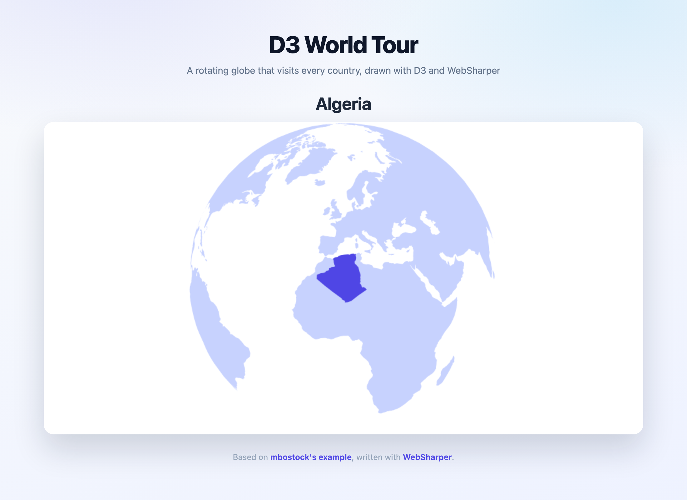

# WebSharper D3 — World Tour

A [WebSharper](https://websharper.com) single-page application that renders
mbostock's classic ["World Tour"](http://bl.ocks.org/mbostock/4183330): a globe
that spins around the world, pausing on every country in turn.

[](https://websharper-samples.github.io/D3)

**[See it running](https://websharper-samples.github.io/D3)**

## How it works

- `src/Client.fs` loads `world-110m.json` (TopoJSON) and
  `world-country-names.tsv`, builds the sorted country list, and drives a
  rotating orthographic projection drawn onto a `<canvas>`.
- `src/wwwroot/index.html` is the page. `topojson.v1.min.js` is vendored next
  to it so the deployed bundle is self-contained.

The sample uses the `WebSharper.D3` bindings for selections, projections and
interpolation (`D3.Select`, `D3.GeoOrthographic`, `D3.Interpolate`). That
binding does not expose D3's geo path/centroid generators, and its transition
API targets D3 v3, so those few calls go through WebSharper's JavaScript
interop — see the comments in `src/Client.fs`.

## Running locally

```
dotnet run --project src
```

Then open <http://localhost:5783>. (The ASP.NET Core default of port 5000
collides with macOS AirPlay Receiver; the port comes from
`src/Properties/launchSettings.json`.)

## Building

```
dotnet build src/D3.fsproj -c Release
```

WebSharper compiles the client and [esbuild](https://esbuild.github.io/) bundles
it into `src/wwwroot/Scripts`.

## Deployment

Every push to `master` builds in Release and publishes `src/wwwroot` to the
`gh-pages` branch via `.github/workflows/deploy.yml`.
